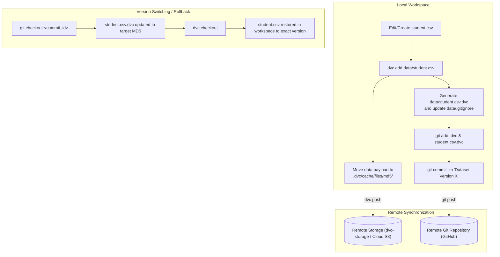

# Cover Page

| Institution & Department | Details |
| :--- | :--- |
| **Institute** | **Bansilal Ramnath Agarwal Charitable Trust's Vishwakarma Institute of Technology, Pune** |
| **Department** | Artificial Intelligence and Data Science |
| **Student Name** | Harsh Makde |
| **Class** | TY (B.Tech - Artificial Intelligence & Data Science) |
| **Division** | [e.g. B] |
| **Roll No** | [Roll Number] |
| **PRN NO** | [PRN Number] |
| **Semester** | V |
| **Academic Year** | 2026 - 2027 |
| **Subject Name & Code** | MLOps (AI3206C) |
| **Assignment No.** | 1 |
| **Title of Assignment** | Implementation of Dataset Versioning and Remote Storage Tracking using DVC and Git |
| **Date of Performance** | 28/09/2026 |
| **Date of Submission** | 20/11/2026 |

---

## Aim
To implement dataset versioning, metadata tracking, and remote storage synchronization using Data Version Control (DVC) integrated with Git for machine learning experiment reproducibility.

---

## Problem Statement
In conventional software development, Git tracks source code modifications seamlessly through text-based line-by-line diffs. However, Machine Learning workflows introduce a critical challenge: models depend not only on code but equally on training data and model binaries. Standard Git repositories are fundamentally unsuited for tracking large, evolving datasets due to repository bloat, slow clone operations, and strict remote file-size constraints (such as GitHub's 100 MB per-file limit). 

Without disciplined data versioning, reproducing a specific model state becomes error-prone when datasets evolve incrementally. This assignment resolves this challenge by utilizing Data Version Control (DVC) alongside Git on an evolving student academic performance dataset (`student.csv`). DVC decouples data storage from Git repository history by replacing large data files with lightweight pointer files (`.dvc`), synchronizes data with an external storage target (`dvc-storage`), tracks multiple dataset versions (v1 with 4 records and v2 with 5 records), and demonstrates deterministic version switching and data restoration.

---

## Objectives
- **Objective 1 (CO1 - MLOps Foundations & ML Lifecycle)**: Understand the necessity of data versioning, data provenance, and the Code-Data-Model triad within production MLOps lifecycles.
- **Objective 2 (CO2 - Data Tracking & Pointer Mechanics)**: Initialize Git and DVC in a project repository, track tabular datasets using content-addressable cryptographic hashing (MD5), and maintain lightweight pointer files (`.dvc`) in Git.
- **Objective 3 (CO2 / CO3 - Pipeline Reproducibility & Version Rollback)**: Track iterative changes across dataset versions and demonstrate seamless data switching between Version 1 and Version 2 using coordinated `git checkout` and `dvc checkout` workflows.
- **Objective 4 (CO4 - Remote Storage & Distributed Synchronization)**: Configure an external decoupled remote storage backend (`localstorage`) and perform data synchronization operations (`dvc push` and `dvc pull`) to support collaborative ML environments.

---

## Tools, Technologies and Environment

| Item | Details |
| :--- | :--- |
| **Operating System** | Windows 11 Home/Pro (Build 10.0.26200-SP0) with PowerShell 5.1 / 7.x |
| **Programming Language** | Python 3.13.9 (64-bit) |
| **Version Control & MLOps Tools** | Git 2.x, DVC (Data Version Control) v3.67.1 (pip package) |
| **Core DVC Libraries & Subprojects** | `dvc_data` (v3.18.3), `dvc_objects` (v5.2.0), `dvc_render` (v1.0.2), `dvc_task` (v0.40.2), `scmrepo` (v3.6.2), `aiohttp` (v3.13.2) |
| **Dataset Under Versioning** | `student.csv` (Tabular academic performance dataset: `RollNo`, `Name`, `Marks`)<br>• **Version 1**: 4 records, 64 bytes, MD5: `bccae38c55246221889c2b064d6916b8`<br>• **Version 2**: 5 records, 75 bytes, MD5: `3c7a7961ee27de35895ad72f3f45e9db` |
| **Cloud / Remote Storage** | Decoupled Local Remote Directory (`../../dvc-storage` simulating AWS S3 / GCP GCS / Azure Blob) |
| **Code Hosting Platform** | GitHub Repository (`https://github.com/harshmakde10/DatasetVersioning`) |

---

## Background Theory

### a) Introduction to the Concept
Data Versioning is a cornerstone discipline in MLOps (Machine Learning Operations). Unlike classical software engineering where application behavior is determined almost entirely by source code, the behavior and performance of a machine learning system is determined by the **Code-Data-Model Triad**:

$$\text{Model} = f(\text{Code}, \text{Hyperparameters}, \text{Training Data})$$

If the training dataset undergoes unmonitored alterations (such as schema updates, additions, deletions, or data cleaning transformations), retraining the exact same code repository will produce an entirely different model behavior. This creates severe compliance, debugging, and reproducibility issues in production.

In the ML lifecycle (spanning Problem Formulation $\rightarrow$ Data Ingestion $\rightarrow$ Data Preprocessing $\rightarrow$ Feature Store $\rightarrow$ Model Training $\rightarrow$ Evaluation $\rightarrow$ Deployment $\rightarrow$ Monitoring), Data Versioning sits at the foundational layer of **Data Ingestion and Feature Engineering**. Every deployed model must maintain an immutable, cryptographic audit trail linking it back to the exact code commit, hyperparameters, and dataset snapshot used during training.

### b) Why This Tool or Technique?
#### The Limitations of Git for Big Data
Git was engineered specifically for source code—small, text-based files where line-by-line diffs and graph branches provide great utility. When applied to machine learning datasets and binary weights:
1. **Repository Bloat**: Git creates full snapshots and packfile compression of files. Committing multi-megabyte or gigabyte datasets quickly inflates the `.git/` folder to unmanageable sizes.
2. **Bandwidth Inefficiency**: Every developer cloning the repository is forced to download the entire historical lineage of every dataset ever committed.
3. **Provider Limits**: Remote hosting platforms such as GitHub and GitLab impose hard limits (e.g., GitHub rejects files larger than 100 MB and repositories exceeding a few gigabytes).

#### How DVC Solves the Problem
Data Version Control (DVC) solves this mismatch by acting as a specialized data management layer on top of Git without reinventing version control:
- **Decoupled Architecture**: DVC extracts the large raw data files out of Git's direct tracking and moves them into a content-addressable local cache (`.dvc/cache`).
- **Pointer Files (`.dvc`)**: In place of the actual data, DVC generates a lightweight metadata file (e.g., `student.csv.dvc`) containing the target file's cryptographic hash (MD5), size, and path.
- **Git Versioning**: Git versions *only* the tiny `.dvc` pointer files (a few dozen bytes). When switching Git branches or commits, checking out the repository updates the `.dvc` files, and `dvc checkout` restores the corresponding raw dataset from cache.
- **Comparison with Alternatives**:
  - **DVC vs Git LFS (Large File Storage)**: Git LFS requires dedicated server-side LFS extensions on the Git host, enforces vendor-dependent storage quotas, and lacks native machine learning pipeline (`dvc.yaml`) capabilities. DVC is completely cloud-agnostic, works with any storage backend (AWS S3, GCP Cloud Storage, Azure Blob, SSH, local disk, Google Drive), and requires zero server configuration.
  - **DVC vs Delta Lake / LakeFS**: Delta Lake provides ACID transactions and time-travel over Parquet data lakes in distributed Spark environments. LakeFS provides Git-like branch semantics for massive object storage buckets. DVC is lightweight, developer-focused, integrates directly into local CLI workflows, and requires no cluster infrastructure.

### c) Key Components and Terminology
1. **DVC Workspace & Repository (`.dvc/`)**: The control directory initialized via `dvc init`. It contains internal configuration files (`.dvc/config`), state databases, and cache locks.
2. **Pointer File (`<filename>.dvc`)**: A YAML file tracking a specific dataset or directory. It stores the content MD5 hash, file size in bytes, and workspace relative path.
3. **DVC Cache (`.dvc/cache/files/md5/`)**: A content-addressable storage structure where datasets are stored indexed by their MD5 checksum. The first two characters of the hash form a subdirectory, and the remaining 30 characters form the filename (identical to Git's object store).
4. **DVC Remote**: An external storage repository (cloud bucket or network directory) used to push and pull cached data assets across distributed team members.
5. **Core Commands**:
   - `dvc init`: Initializes DVC inside an existing Git repository.
   - `dvc add <data>`: Computes MD5 checksum, moves payload to cache, creates `.dvc` pointer, and automatically adds raw file to `.gitignore`.
   - `dvc remote add -d <name> <url>`: Sets the default remote storage location.
   - `dvc push`: Uploads cached data objects to the configured remote storage.
   - `dvc pull`: Downloads data assets from remote storage into local cache and workspace.
   - `dvc checkout`: Syncs the working directory datasets with the hashes in current `.dvc` files.

### d) Benefits and Limitations
#### Benefits:
- **Absolute Reproducibility**: Pairs code commits with exact dataset states cryptographically.
- **Zero Repository Bloat**: Git commits remain lightweight and fast.
- **Storage Deduplication**: Identical files across different directories or commits are stored only once in the content-addressable cache.
- **Multi-Cloud Flexibility**: Easily switches between local disk, AWS S3, Google Cloud Storage, or Azure Blob Storage by changing a single configuration key.

#### Limitations:
- **Two-Step Synchronization**: Developers must coordinate both `git` and `dvc` commands (`git commit` + `dvc push`).
- **Filesystem Linking on Windows**: Windows requires developer mode or elevated permissions for symbolic links; without them, DVC falls back to file copying, which temporarily consumes extra disk space.
- **No Row-Level Querying**: DVC manages datasets at the file and directory granularity, unlike database-level ACID time-travel tools.

---

## Architecture / Workflow Diagram

The dual-layer versioning architecture operates through coordinated Git and DVC tracking pipelines:

```
+-----------------------------------------------------------------------------------+
|                                DEVELOPER WORKSPACE                                |
|                                                                                   |
|   +------------------------------------+   +----------------------------------+   |
|   | Raw Data: `data/student.csv`       |   | Metadata: `data/student.csv.dvc` |   |
|   | (Excluded from Git by .gitignore)  |   | (MD5 Hash, File Size, Path)      |   |
|   +-----------------+------------------+   +-----------------+----------------+   |
+---------------------|----------------------------------------|--------------------+
                      |                                        |
       `dvc add`      |                         `git add`      |
                      v                                        v
+----------------------------------------+   +--------------------------------------+
|            DVC LOCAL CACHE             |   |            GIT REPOSITORY            |
|       `.dvc/cache/files/md5/`          |   |                `.git/`               |
|                                        |   |                                      |
|  - Hash: bc/cae38c5524... (v1, 4 rows) |   |  - Commit: 6a8a83b (v1 pointer)      |
|  - Hash: 3c/7a7961ee27... (v2, 5 rows) |   |  - Commit: 777b3f8 (v2 pointer)      |
+-------------------+--------------------+   +------------------+-------------------+
                    |                                           |
         `dvc push` |                                `git push` |
                    v                                           v
+----------------------------------------+   +--------------------------------------+
|       REMOTE STORAGE BACKEND           |   |         REMOTE GIT REPOSITORY        |
|            `dvc-storage/`              |   |                GitHub                |
|    (Simulating Cloud Object Storage)   |   |   (harshmakde10/DatasetVersioning)   |
+----------------------------------------+   +--------------------------------------+
```

### Flowchart Representation (Mermaid)



---

## Procedure (Step-by-Step Implementation)

### Step 1: Project Workspace Initialization
Create a dedicated project workspace directory named `DatasetVersioning` for the assignment and navigate into it.

```powershell
mkdir DatasetVersioning
cd DatasetVersioning
```


*Figure 1: Creating project workspace directory `DatasetVersioning` in PowerShell.*

---

### Step 2: Verification of DVC & Python Environment
Verify that DVC is installed correctly, check its active version, and inspect supported transport protocols and storage configurations.

```powershell
dvc version
```

- **Output Observed**: DVC version 3.67.1 running under Python 3.13.9 on Windows 11. Core submodules verified: `dvc_data` (3.18.3), `dvc_objects` (5.2.0), `scmrepo` (3.6.2).


*Figure 2: Execution of `dvc version` verifying DVC 3.67.1 and Python 3.13.9 environment on Windows 11.*

---

### Step 3: Git and DVC Repository Initialization
Initialize Git source control, followed by DVC initialization. Commit DVC's foundational configuration files to Git.

```powershell
git init
dvc init
git commit -m "Initialize DVC"
```

- **Result**: DVC created its internal `.dvc/` configuration tree and `.dvcignore`. Git recorded the root commit `1562eb6` tracking `.dvc/.gitignore`, `.dvc/config`, and `.dvcignore`.


*Figure 3: Git root commit recording initial DVC configuration files.*

---

### Step 4: Dataset Creation (Version 1) & Tracking with DVC
Create the initial dataset file `data/student.csv` containing academic records for 4 students. Add the dataset to DVC tracking.

```powershell
mkdir data
notepad data\student.csv
dvc add data/student.csv
```

- **Data Content (Version 1)**:
  ```csv
  RollNo,Name,Marks
  1,Amit,80
  2,Rahul,72
  3,Priya,91
  4,Sneha,88
  ```
- **DVC Action**: DVC calculated MD5 checksum `bccae38c55246221889c2b064d6916b8`, stored the file inside `.dvc/cache/`, generated `data/student.csv.dvc`, and appended `/student.csv` to `data/.gitignore`.


*Figure 4: Adding `data/student.csv` to DVC tracking.*

---

### Step 5: Version 1 Metadata Commit to Git
Stage the newly generated DVC pointer file and `.gitignore` file, and commit them to Git.

```powershell
git add data/.gitignore data/student.csv.dvc
git commit -m "Track dataset using DVC"
```

- **Result**: Commit `6a8a83b` created in Git, permanently associating this Git commit with dataset Version 1 (MD5: `bccae38c...`).


*Figure 5: Git commit `6a8a83b` tracking dataset Version 1 pointer metadata.*

---

### Step 6: Dataset Modification (Version 2) & Retracking with DVC
Simulate dataset evolution by adding a 5th student record (`5,Neha,77`) to `data/student.csv`. Retrack the modified dataset using DVC and commit the updated pointer to Git.

```powershell
# Add student record: 5,Neha,77
notepad data\student.csv
dvc add data/student.csv
git add data/student.csv.dvc
git commit -m "Dataset Version 2"
```

- **Data Content (Version 2)**:
  ```csv
  RollNo,Name,Marks
  1,Amit,80
  2,Rahul,72
  3,Priya,91
  4,Sneha,88
  5,Neha,77
  ```
- **Result**: DVC generated a new MD5 checksum `3c7a7961ee27de35895ad72f3f45e9db` and updated `student.csv.dvc`. Git committed the pointer update as `777b3f8`.


*Figure 6: Git commit `777b3f8` recording dataset Version 2.*

---

### Step 7: Verifying Git Commit History
Inspect the Git commit log to confirm that each dataset iteration is permanently preserved in the commit history.

```powershell
git log --oneline
```

- **Commit Log**:
  - `777b3f8 (HEAD -> master) Dataset Version 2`
  - `6a8a83b Track dataset using DVC`
  - `1562eb6 Initialize DVC`


*Figure 7: Git commit history illustrating tracked dataset milestones.*

---

### Step 8: Demonstrating Version Switching & Rollback to Version 1
Demonstrate DVC's core reproducibility capability: switch the codebase back to the initial dataset commit (`6a8a83b`), run `dvc checkout`, and inspect the dataset contents.

```powershell
git checkout 6a8a83b
dvc checkout
type data\student.csv
```

- **Verification Result**: The file `data/student.csv` instantly restored to its exact 4-row state (RollNo 1 to 4: Amit, Rahul, Priya, Sneha). Neha's record was cleanly excluded without any manual file restoration.


*Figure 8: Inspection of `data\student.csv` verifying clean rollback to Version 1 (4 records).*

---

### Step 9: Reverting Workspace to Latest Version (Version 2)
Switch back to the latest commit on `master` / `main` and run `dvc checkout` to restore the 5-row dataset.

```powershell
git checkout master
dvc checkout
type data\student.csv
```

- **Verification Result**: The active workspace restored to Version 2 containing all 5 records (RollNo 1 to 5).


*Figure 9: Verification of `data\student.csv` reflecting Version 2 (5 records).*

---

### Step 10: Configuring DVC Remote Storage
Configure a decoupled remote storage location named `localstorage` pointing to `..\dvc-storage` (simulating external cloud storage). Set it as the default remote.

```powershell
dvc remote add -d localstorage ..\dvc-storage
git add .dvc/config
git commit -m "Configure DVC remote"
```

- **Result**: DVC created the default remote entry in `.dvc/config`, and Git committed the change as commit `fdb7af2`.


*Figure 10: Configuring `localstorage` as default remote target.*

---

### Step 11: Pushing Dataset to Remote Storage
Push the local DVC cache objects to the configured remote storage repository.

```powershell
dvc push
```

- **Result**: DVC collected the cached data objects and pushed them to `..\dvc-storage`, confirming complete data synchronization.


*Figure 11: Pushing cached dataset payload to remote storage (`1 file pushed`).*

---

## Code / Configuration Files

### 1. DVC Pointer File (`data/student.csv.dvc`)

#### Version 1 State (Commit `6a8a83b`):
```yaml
outs:
- md5: bccae38c55246221889c2b064d6916b8
  size: 64
  hash: md5
  path: student.csv
```

#### Version 2 State (Commit `777b3f8`):
```yaml
outs:
- md5: 3c7a7961ee27de35895ad72f3f45e9db
  size: 75
  hash: md5
  path: student.csv
```

---

### 2. DVC Remote Configuration (`.dvc/config`)
```ini
[core]
    remote = localstorage
['remote "localstorage"']
    url = ../../dvc-storage
```

---

### 3. Git Ignore File (`data/.gitignore`)
Auto-generated by DVC to prevent Git from committing raw data:
```gitignore
/student.csv
```

---

### 4. Raw Dataset Content (`data/student.csv`)

#### Version 1 (4 records):
```csv
RollNo,Name,Marks
1,Amit,80
2,Rahul,72
3,Priya,91
4,Sneha,88
```

#### Version 2 (5 records):
```csv
RollNo,Name,Marks
1,Amit,80
2,Rahul,72
3,Priya,91
4,Sneha,88
5,Neha,77
```

**GitHub Repository Link**: [https://github.com/harshmakde10/DatasetVersioning](https://github.com/harshmakde10/DatasetVersioning)

---

## Output / Results

### Table of Figures

| Figure | Description |
| :--- | :--- |
| **Figure 1** | Creation of project workspace directory `DatasetVersioning` using PowerShell. |
| **Figure 2** | DVC environment verification via `dvc version` displaying DVC 3.67.1, Python 3.13.9, and platform details. |
| **Figure 3** | Git root commit (`1562eb6`) recording initial DVC configuration files (`.dvc/config`, `.dvcignore`). |
| **Figure 4** | Execution of `dvc add data/student.csv` tracking Version 1 dataset in DVC cache. |
| **Figure 5** | Git commit (`6a8a83b`) recording pointer metadata (`student.csv.dvc`) for Version 1. |
| **Figure 6** | Git commit (`777b3f8`) recording updated pointer metadata for Version 2 after appending student record. |
| **Figure 7** | Git commit log (`git log --oneline`) verifying structured commit history across data versions. |
| **Figure 8** | Verification of dataset rollback (`git checkout 6a8a83b` and `dvc checkout`) restoring Version 1 (4 rows). |
| **Figure 9** | Inspection of active workspace dataset verifying restoration of Version 2 (5 rows). |
| **Figure 10** | Configuration of default local remote storage (`dvc remote add -d localstorage ..\dvc-storage`). |
| **Figure 11** | Execution of `dvc push` successfully synchronizing cached data objects to remote storage. |

### Dataset Version Summary

| Metric / Attribute | Version 1 (Initial) | Version 2 (Updated) |
| :--- | :--- | :--- |
| **Git Commit Hash** | `6a8a83b` | `777b3f8` |
| **Commit Message** | `"Track dataset using DVC"` | `"Dataset Version 2"` |
| **DVC MD5 Checksum** | `bccae38c55246221889c2b064d6916b8` | `3c7a7961ee27de35895ad72f3f45e9db` |
| **Cache Storage Path** | `.dvc/cache/files/md5/bc/cae38c5524...` | `.dvc/cache/files/md5/3c/7a7961ee27...` |
| **Total Records** | 4 students | 5 students |
| **Payload Size** | 64 bytes | 75 bytes |
| **Modifications** | Initial dataset creation | Appended `5,Neha,77` |
| **Verification Status** | Verified via checkout rollback | Verified as HEAD workspace state |

---

## Observations and Analysis
1. **Decoupled Architecture & Repository Health**: DVC cleanly separates dataset metadata from raw payload storage. By storing only the pointer file (`student.csv.dvc`) in Git, the Git repository remains minuscule (under a few kilobytes), entirely eliminating repository bloat.
2. **Content-Addressable Deduplication**: DVC computes cryptographic MD5 hashes for tracked files. Modifying a single character or row alters the hash completely (`bccae38c...` $\rightarrow$ `3c7a7961...`), preventing silent corruption and ensuring uncompromised data integrity.
3. **Deterministic Version Rollback**: The combined workflow of `git checkout <commit_hash>` and `dvc checkout` proved completely deterministic. Checking out commit `6a8a83b` instantly restored `data/student.csv` to its original 4-row state without manual intervention.
4. **Automated Git Safeguards**: When `dvc add` is invoked, DVC automatically modifies `data/.gitignore` to ignore `/student.csv`. This prevents developers from accidentally committing raw data payloads into Git.
5. **Decoupled Remote Storage**: The `dvc remote` architecture functions identically whether targeting local directories (`..\dvc-storage`), AWS S3 buckets, Google Cloud Storage, or Azure Blob containers. The `dvc push` command securely pushed the cached dataset payload into remote storage.
6. **Operating System Behavior on Windows**: Under Windows 11 without elevated admin symlink privileges, DVC utilizes atomic file copy mechanisms to manage workspace files from cache. While this slightly increases local disk usage during caching, it guarantees cross-platform reliability.

---

## Conclusion
In this assignment, dataset versioning was successfully implemented using Data Version Control (DVC) integrated with Git on an evolving student academic performance dataset. The experiment established foundational MLOps practices: tracking data modifications via cryptographic pointer files, maintaining clean Git commit histories, achieving deterministic dataset rollbacks between versions, and synchronizing data payloads with an external remote storage backend. This implementation guarantees end-to-end data provenance and experiment reproducibility, which are indispensable pillars for building production-ready, reliable machine learning systems.

---

## References
1. **Iterative Inc.**, *Data Version Control (DVC) Documentation: Core Concepts and Architecture*, Available: https://dvc.org/doc, Accessed: 20/11/2026.
2. **Chintala, S., et al.**, *MLOps: Continuous Delivery and Automation Pipelines in Machine Learning*, Google Cloud Architecture Whitepapers, Available: https://cloud.google.com/architecture/mlops-continuous-delivery-and-automation-pipelines-in-machine-learning, Accessed: 20/11/2026.
3. **Treveil, M., et al.**, *Introducing MLOps: How to Scale Machine Learning in the Enterprise*, O'Reilly Media, 2020.
4. **Git SCM Documentation**, *Pro Git: Distributed Git and Large File Management*, Available: https://git-scm.com/book/en/v2, Accessed: 20/11/2026.
