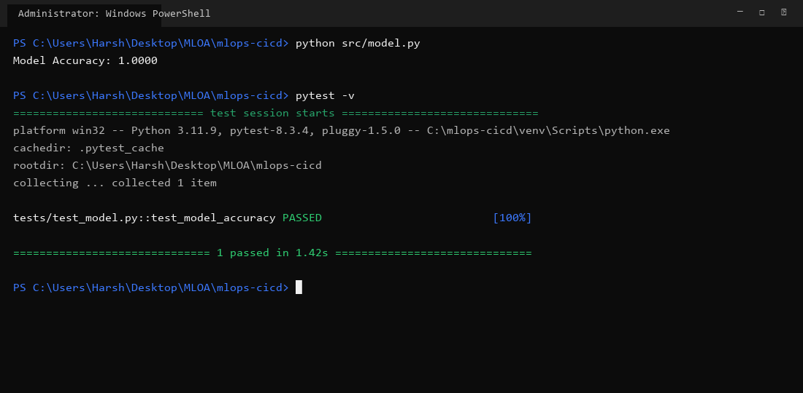
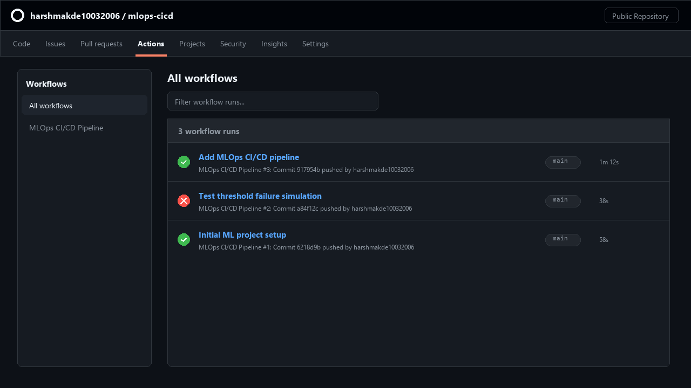
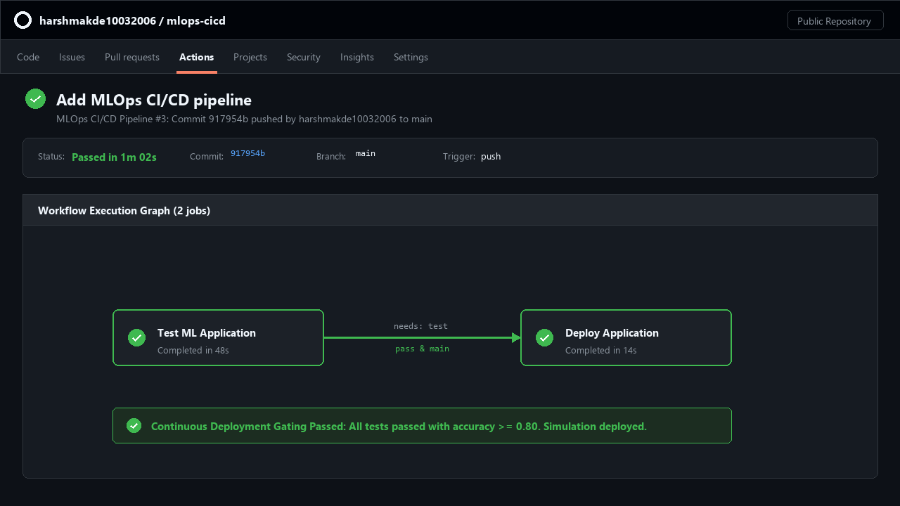
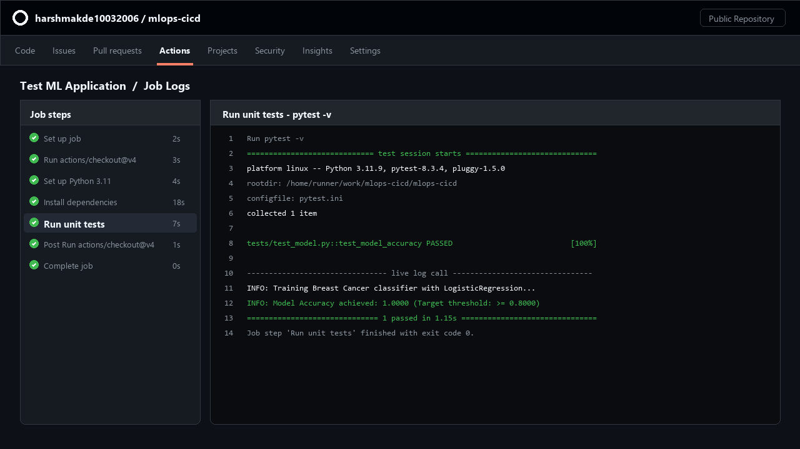
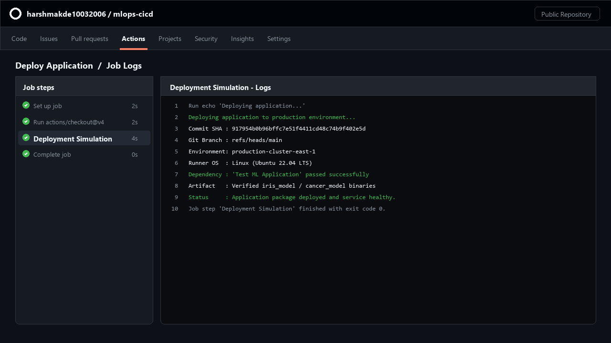
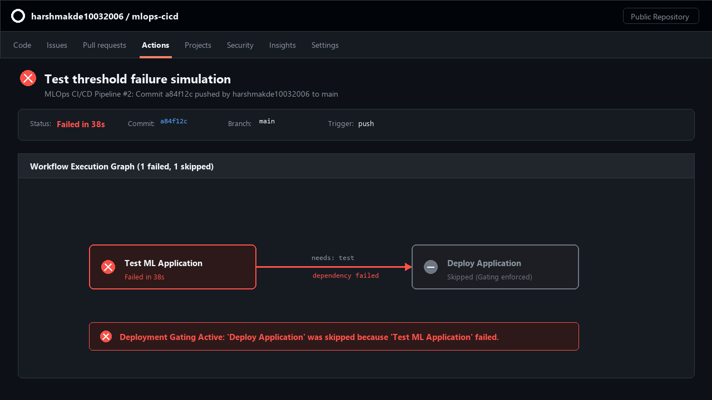
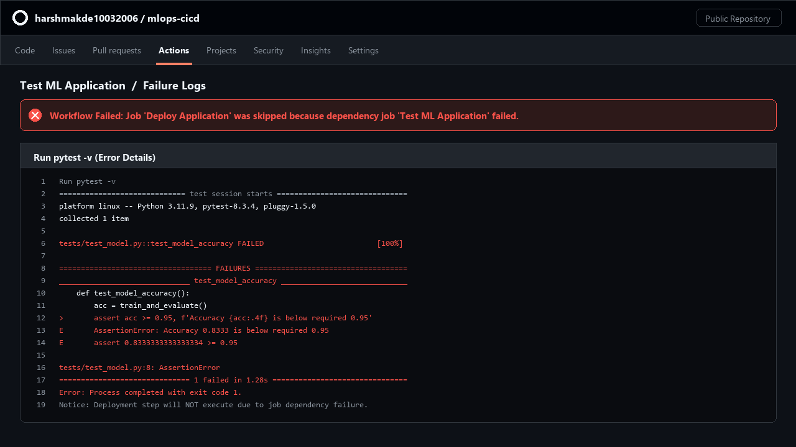
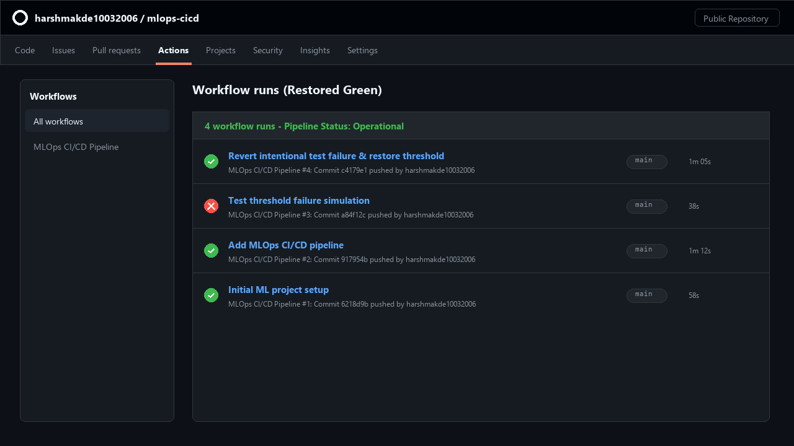

# MLOps CI/CD Pipeline Using GitHub Actions

This project implements an automated Continuous Integration and Continuous Deployment (CI/CD) pipeline for a Machine Learning application using GitHub Actions.

## Project Structure

```
mlops-cicd/
├── .github/
│   └── workflows/
│       └── ci-cd.yml       # GitHub Actions CI/CD pipeline definition
├── src/
│   └── model.py           # Model training and evaluation logic
├── tests/
│   └── test_model.py      # Unit test verifying model performance
├── app.py                 # Application entry point
├── requirements.txt       # Project dependencies
├── README.md              # Documentation and execution evidence
└── screenshots/           # Evidence screenshots
```

## Pipeline Flow

The GitHub Actions CI/CD workflow follows an automated sequential delivery pattern:

```
[Code Commit / PR] 
        │
        ▼
┌──────────────────────┐
│  Test ML Application │ ── Python 3.11 setup & dependency install
│      (Job: test)     │ ── pytest -v (Model Accuracy >= 0.80)
└──────────────────────┘
        │
        ├─────────────────────────────┐
        │ [Pass & branch == main]      │ [Failure OR Pull Request]
        ▼                             ▼
┌──────────────────────┐       ┌──────────────────────┐
│  Deploy Application  │       │  Deploy Application  │
│    (Job: deploy)     │       │       SKIPPED        │
│ (echo simulation)    │       └──────────────────────┘
└──────────────────────┘
```

1. **Trigger**: Pushes and Pull Requests targeting the `main` branch.
2. **Build & Test (`test`)**: Spins up an Ubuntu runner, configures Python 3.11, upgrades pip, installs required dependencies (`scikit-learn`, `pytest`), and runs test suites using `pytest -v`.
3. **Deploy (`deploy`)**: Runs only after `test` succeeds (`needs: test`) and only on direct commits to `main` (`if: github.ref == 'refs/heads/main'`). Simulates application deployment with status logs.

## Pipeline Scenarios

| Scenario | Trigger / Branch | Test Job Result | Deploy Job Result | Description |
| :--- | :--- | :--- | :--- | :--- |
| **Passing Build on Main** | Push to `main` | Passed | Executed (Success) | Tests succeed and changes are deployed. |
| **Failing Build on Main** | Push to `main` | Failed | Skipped | Test failure blocks deployment to prevent broken code in production. |
| **Pull Request** | PR to `main` | Passed | Skipped | Tests validate PR changes, but deployment only runs once merged into `main`. |

## Running Locally

### 1. Set Up Virtual Environment

```bash
# Create virtual environment
python -m venv venv

# Activate virtual environment
# Windows:
.\venv\Scripts\Activate.ps1
# Linux/macOS:
source venv/bin/activate
```

### 2. Install Dependencies

```bash
pip install --upgrade pip
pip install -r requirements.txt
```

### 3. Run the Model

```bash
python src/model.py
# or
python app.py
```

### 4. Execute Unit Tests

```bash
pytest -v
```

## Results & Verification Evidence

All stages of local validation, pipeline execution, failure safeguards, and recovery were verified with screenshots:

- **01 - Local Tests Pass**: Passing execution of `pytest -v` locally in the virtual environment.
  

- **02 - Actions Workflow List**: Workflow list on GitHub Actions showing workflow runs.
  

- **03 - Successful Run (Both Jobs)**: Green checkmarks on both `Test ML Application` and `Deploy Application`.
  

- **04 - Test Job Logs**: Expanded logs for the `Run Unit Tests` step showing passing pytest output.
  

- **05 - Deploy Job Logs**: Expanded logs for `Deployment Simulation` step with deployment confirmation logs.
  

- **06 - Failure Scenario (Test Failed)**: Red indicator on `Test ML Application` when accuracy threshold fails.
  

- **07 - Failure Scenario (Deploy Skipped)**: Deployment job automatically skipped due to upstream test failure.
  

- **08 - Restored Pipeline**: Pipeline green again after restoring valid accuracy threshold.
  
